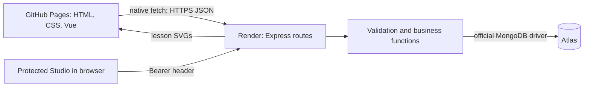
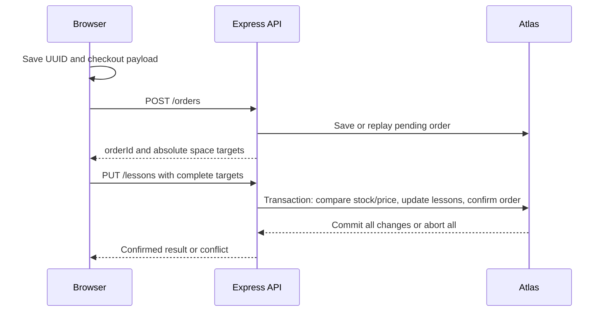

# AfterClass — developer-to-student handover

Prepared on 17 October 2026. Read this alongside [README.md](README.md), [SUBMISSION_GUIDE.md](SUBMISSION_GUIDE.md), [VERIFICATION.md](VERIFICATION.md) and [AI_ACKNOWLEDGEMENT.md](AI_ACKNOWLEDGEMENT.md).

## 1. Who did what, and how to use this guide

The requesting user identifies as a developer providing paid assistance to a student. That developer commissioned and directed the work in this conversation, supplied configuration information, completed private account/credential steps and authorised deployment and live verification. OpenAI Codex generated or edited implementation, tests, design, documentation and deployment/packaging tooling as recorded in the acknowledgement. The conversation does not establish that the student authored the implementation, reviewed it, rehearsed it or approved these actions.

The developer should provide this record with the source and explain their actual contribution. The student should confirm with the module team whether this commissioned work is permitted and what disclosure is required before using it in an assessment. Understanding the implementation does not change its authorship. Record subsequent student edits and exercises honestly; existing commit counts document development history, not independent student authorship.

Use the explanations and exercises during preparation. During the assessed demonstration follow the handbook's prohibition on AI assistance. Do not use this guide as a script to claim authorship or as an unauthorised aid in the assessed session. No completed independent rehearsal is recorded here.

## 2. What is being handed over

AfterClass is a fictitious North London after-school lesson catalogue and booking application. It uses GBP, twelve seed lessons and four seed teachers. It has no payment processing, public accounts or public registration.

The coursework flow is catalogue → basket → validated contact details → pending order → transactional confirmation. Required challenges are server-side search, teacher filtering and enrolment counted from confirmed purchased quantities. Extensions include detailed lesson pages, saved shortlists, category/availability filters and protected Studio management of lessons and teachers.

| Resource | Address |
|---|---|
| Live catalogue | https://gantalaavinash.github.io/after_class_simple_brainstrome/ |
| Protected Studio | https://gantalaavinash.github.io/after_class_simple_brainstrome/admin.html |
| Live API catalogue | https://afterclass-21j41a62f1.onrender.com/lessons |
| Deployment repository | https://github.com/GantalaAvinash/after_class_simple_brainstrome |
| Separate frontend history | https://github.com/GantalaAvinash/afterclass-frontend |
| Separate backend history, private | https://github.com/GantalaAvinash/afterclass-backend |

The configured coursework identifier is **21j41a62f1**, supplied by the developer. The student must verify that it is their correct required identifier before submission. Do not rename services or replace it without checking the coursework requirement and updating all references.

The combined repository is the active deployment source. Pages publishes frontend/ and Render runs backend/. The two separate repositories preserve genuine histories and are synchronised for packaging. Their commit totals and exact source versions are recorded in PACKAGE_MANIFEST.json inside the ZIP. A private repository link does not give the assessor access.

The dated Atlas export has 12 lessons, five teacher records including one soft-deleted QA teacher, one confirmed fictitious order and five admin audit entries. That order bought two Coding Club places and one Art Workshop place; the snapshot has three and four available places respectively, 57 available places overall, and four public teachers. These are dated verification records; do not assume later live stock is identical.

## 3. Read the code in this order

Start with one behaviour at a time. For each row, find the named function and explain its inputs, output and caller before moving on.

| Order | Files | What to learn |
|---|---|---|
| 1 | [frontend/index.html](frontend/index.html), [frontend/app.js](frontend/app.js) | Vue template, data(), computed values, methods, watchers and mounted() |
| 2 | [frontend/state.mjs](frontend/state.mjs) | availableSpace, sortLessons, changeCart, cartLines, contactErrors |
| 3 | [frontend/api.mjs](frontend/api.mjs) | resolveApiBase, createApi, fetch, JSON and HTTP failures |
| 4 | [backend/src/server.js](backend/src/server.js), [app.js](backend/src/app.js), [middleware.js](backend/src/middleware.js) | Start-up, request pipeline, logging, CORS, images and safe errors |
| 5 | [backend/src/catalogue.js](backend/src/catalogue.js), [validation.js](backend/src/validation.js) | Routes, ObjectIds, literal search, teacher filtering and input validation |
| 6 | [frontend/checkout.mjs](frontend/checkout.mjs), [backend/src/orders.js](backend/src/orders.js), [updates.js](backend/src/updates.js) | Persisted attempt, pending order, exact space targets, replay and transactions |
| 7 | [backend/src/enrolment.js](backend/src/enrolment.js) | Confirmed quantity aggregation |
| 8 | [frontend/lesson-route.mjs](frontend/lesson-route.mjs), [discovery.mjs](frontend/discovery.mjs) | Detail routing, cancellation, saved IDs and extra client filters |
| 9 | [frontend/admin-app.js](frontend/admin-app.js), [admin-state.mjs](frontend/admin-state.mjs) | Studio screens, memory-only authentication, revisioned mutations and retry |
| 10 | [backend/src/admin-auth.js](backend/src/admin-auth.js), [admin.js](backend/src/admin.js), [teachers.js](backend/src/teachers.js) | Protected CRUD, relationship ownership, audit and soft deletion |
| 11 | frontend/test/, backend/test/, backend/scripts/ | Evidence, test limits, export and packaging commands |

CSS is split across styles.css, experience.css, lesson-detail.css and admin.css. Vue is vendored under frontend/vendor with its version and licence. Lesson SVGs and their attribution are under backend/public/images. The page does not require a bundler or a frontend build command.

## 4. Architecture and request lifecycle

The browser runs Vue 3.5.44 using the Options API. Node 24 runs Express 5.3.0; the official MongoDB driver 7.7.0 communicates with Atlas. package-lock.json fixes backend dependency resolution.



1. server.js reads private configuration through config.js and connects using database.js. Startup pings Atlas and creates unique order-request and operational TTL indexes.
2. createApp registers request logging first, then CORS, JSON parsing, static images and application routes. An Origin is the scheme/host/port, so the allowed Pages value has no repository path.
3. Each route validates input before database work. recordId converts a valid 24-character hexadecimal string to a native ObjectId; arbitrary MongoDB operators and unsupported fields are rejected.
4. Route results are JSON. The logger records timestamp, method, URL, HTTP status and elapsed milliseconds after the response finishes. It does not record passwords or request bodies.
5. Unknown routes/images and invalid input receive explicit errors. Unhandled errors receive a safe message rather than a connection string or stack trace.

CORS controls browser cross-origin access; it is not an admin permission system. Protected routes separately verify a bearer session. The JSON body limit is 20KB. /health pings the database, so HTTP reachability alone does not prove database health.

## 5. Database model and relationships

| Collection | Important fields | Purpose |
|---|---|---|
| lesson | _id, topic, location, price, space, image; description, learningOutcomes, ageGroup, durationMinutes; revision/deleted/timestamps after mutations | Current lesson content and remaining availability |
| teacher | _id, firstName, lastName, lessonIds; specialism, bio; revision/deleted/timestamps after mutations | Teaching profile and canonical lesson assignments |
| order | _id, requestId, name, phone, items, payloadHash, status, createdAt, confirmedAt after confirmation | Pending/confirmed purchases and replay protection |
| adminAudit | operation UUID, username, action, entity IDs, occurredAt, saved result and mutation evidence | Management history and exact request replay |
| adminSession / adminLoginAttempt | token digests/expiry or login counters | Operational authentication state, excluded from submission exports |

Each order item saves lessonId, quantity, unitPrice, spaceBefore and spaceAfter. Phone is a string, preserving leading zeros. IDs are ObjectIds inside MongoDB and strings in HTTP JSON. The export uses strict Extended JSON so IDs, dates and numeric types can be restored correctly.

A teacher can teach several lessons and a lesson can have several teachers. The single stored relationship is teacher.lessonIds. A lesson's teacherIds in admin responses is derived; it is not a second independent assignment collection. Changing assignments in either editor updates the same relationship and advances affected revisions. This prevents a stale opposite-side form silently undoing a change.

Seeding uses $setOnInsert. Re-running seed inserts missing fixed IDs and does not put sold places back. seed:details fills only missing descriptive content on the fixed seed records; it is not a general stock reset.

Public route contracts and example POST/PUT bodies are in [backend/README.md](backend/README.md); protected management contracts are in [ADMIN_API.md](backend/docs/ADMIN_API.md). Read those beside the function traces below.

## 6. Catalogue, basket and detail state

app.js owns lessons as an ID-indexed dictionary, resultIds for the latest server-filtered result and cart as an ID → quantity dictionary. This separation matters: filtering a lesson out of the visible results must not remove its basket quantity or its cached information.

availableSpace calculates max(0, stored lesson.space − cart quantity). With stored space five and basket quantity two, the page shows three available to add; Atlas still holds five until checkout confirmation. Basket additions do not reserve places for other users. changeCart accepts a single-place addition/removal, refuses additions at zero and removes zero-quantity entries. Removing the last line returns to the catalogue; an empty basket button stays disabled.

The first add shows a visible notification for six seconds, a selected-quantity note and a View cart action on the lesson. Use the cart's labelled plus/minus controls for additional places; the plus button disables at the server's stock limit. Decreasing to zero removes that line. Quantity controls lock during an unfinished checkout. The detail page uses the same feedback and state.

sortLessons returns a sorted copy. Topic/location use locale-aware text comparison; price and displayed available spaces use subtraction. This is why 9 sorts before 100. There are four fields × two directions. An ID tie-break makes equal values deterministic. v-for renders records, v-on connects controls to methods and v-model binds input values. Computed properties derive visibleLessons, basket lines, totals and checkout eligibility; methods perform actions and requests.

Lesson details use #/lessons/:id. The fragment lets a static Pages deployment load a detail URL without needing a server route for that path. lessonRoute validates it; createLessonLoader cancels superseded loads and checks response shape. Details and catalogue share the same basket. Missing/deleted details receive an error state. Ordinary browsing baskets live in memory and disappear on reload; an unfinished checkout is restored separately.

Saved shortlist IDs use localStorage. Unfinished checkout and admin mutation payloads use sessionStorage. Admin bearer tokens use neither: they live only in a JavaScript closure. Never describe all three as the same persistence mechanism.

## 7. Search, teachers and enrolment

Changing searchTerm or teacherId schedules loadLessons. It builds q/teacherId parameters, aborts the preceding request and increments requestVersion. A response can update the view only if its version is still current, preventing an older response from replacing a newer search.

On the server, findLessons validates the query, excludes deleted lessons and resolves an active selected teacher. It queries lessons restricted to that teacher's lessonIds, then performs case-insensitive literal substring matching across topic, location and stringified price/space. Punctuation is literal; input is not executed as a regular expression. The search runs on the backend. Category, shortlist and available-only controls are additional client-side filters applied to its result. Search uses stored stock, while displayed available space also subtracts the current basket.

GET /enrolment/:lessonid finds confirmed orders containing that lesson and sums their purchased quantities. Pending orders contribute zero. A quantity of three counts as three, not one order. Editing available spaces must not rewrite this purchase history. For example, a confirmed quantity two remains enrolment two after an authorised spaces edit to eight. Enrolment is not five minus current spaces.

## 8. Trace a complete checkout

Use this trace to explain the transaction in your own words. The example assumes a practice lesson has five places and the basket requests two.

1. app.js checkout checks canCheckout. Browser and server require a nonempty letters-only name and digits-only phone; checkout names cannot contain spaces, although teacher profile names have broader Unicode rules. Ava / 007123456 is fictitious valid input. Email is optional; a supplied address is trimmed and validated on both sides, saved with the order and preserved on reload. No email is sent. Blank email is omitted so old retry hashes stay compatible.
2. createAttempt creates one UUID and a payload with quantities. saveAttempt stores it before the request. Double-click protection and cartLocked prevent concurrent edits while an outcome is uncertain.
3. submitAttempt POSTs /orders. normaliseOrder checks the UUID, contact fields, nonempty unique lesson items and positive integer quantities. The server reads current stock/price and stores a pending order item with spaceBefore five, spaceAfter three and the current unitPrice. Pending does not deduct stock.
4. The server returns orderId, pending status and the complete proposed absolute updates. The browser saves the response and PUTs /lessons with that order ID and those targets.
5. normaliseUpdates and checkTargets require every saved item exactly once and only its matching space value. Supplying an order ID cannot grant permission to edit arbitrary fields.
6. confirmOrder runs a native driver transaction. For each item, updateOne matches its ID, expected original stock, saved price and active status. It sets the absolute target space and increments revision. The order becomes confirmed in the same transaction. Operations inside that transaction are sequential.
7. If another purchase changed stock, or a lesson was deleted/repriced, a failed match produces a conflict. Throwing aborts the entire transaction, including any earlier item updates. Two customers competing for the last place cannot both confirm it.
8. On success the browser verifies confirmation, clears the attempt/basket/contact fields, announces the order reference and refreshes availability. A refresh failure after confirmation is reported as such; it does not imply that the order failed.



A unique requestId index and normalised payload hash protect POST replay. The same ID and same details return the same order; changed details with that ID return 409. Confirmed PUT replay verifies the target set and returns confirmation without deducting again. On reload restoreAttempt deliberately discards the locally saved server result and re-POSTs the same request ID to discover authoritative status. A network/lost-response failure retains the attempt. Definitive 400/404/409 errors clear it for correction while preserving the basket and refreshing availability.

General PUT without orderId is different: it requires admin authentication and can set declared editable lesson fields to absolute values. It uses a transaction and audit entry. It is not the UUID-replayed Studio mutation contract; repeating it creates another audit entry and revision change. Use the Studio routes for managed CRUD and saved-operation retry.

## 9. Understand protected Studio and teacher management

Start at admin.html → admin-app.js. createAdminClient signs in at /admin/session and holds the returned bearer token in a closure. The password input is cleared after sign-in attempts. Reload requires signing in again. Logout revokes the server session; expiry or 401 clears the client token.

On the backend, hashPassword uses native salted scrypt. Only a hash is configured; no public default password exists. Database session records store token digests. Sessions last 30 minutes and check expiry/current credential version on each protected request. Login attempts are globally counted: ten attempts in a fixed 15-minute window, including successful/unknown-user attempts. A TTL cleanup delay never makes an expired session valid. This is a single-operator educational extension, with no MFA or multi-user roles.

In Studio, choose Lessons → Create lesson to enter topic, location, price, spaces, an allowed supplied image, optional detail content and teacher membership. Edit sends the complete editable form and current revision. Delete hides the record; Deleted lessons supports restore. Teaching team → Create teacher accepts first/last name, optional specialism/bio and assigned lesson checkboxes. Edit profile & assignments updates that set; deleted profiles can be restored.

A management request includes a UUID. Update/delete/restore also include the current revision. The transaction checks that revision, changes the record/associations and saves an audit result together. Repeating the same UUID/details returns that saved result. A lost response can be retried using the saved mutation after re-authentication. On a stale 409, reload and reopen the form; do not overwrite the new revision manually.

Lesson and teacher deletion are soft deletions. Public profiles/results hide them; confirmed order history is retained. Teacher deletion keeps its assignment IDs for restoration and does not change prices, spaces or orders. Overview displays confirmed quantities and saved-price booking value without customer contact details; it is a small-catalogue read, not payment accounting.

For exact request/response bodies, limits and errors, read [backend/docs/ADMIN_API.md](backend/docs/ADMIN_API.md). Do not put real passwords/tokens into this guide, screenshots, Postman exports or the ZIP.

## 10. Run a safe practice copy

Use an extracted ZIP or a separate clone. This keeps exercises apart from the developer's working copy and hosted assessment database. Node 24, npm and Python 3 are needed; no frontend build step is required.

```sh
cd backend
npm ci
npm test
cd ../frontend
node --test test/*.test.mjs
```

Expected: 54 backend checks pass, three native Atlas tests skip without test credentials, and 32 frontend checks pass. A skip is not a native-database pass. The previous real Atlas run passed those three tests separately.

For the disposable preview, from backend:

```sh
PREVIEW_PORT=8082 npm run preview:test
```

Open http://127.0.0.1:8082. The preview supplies its own API configuration and a visible fixture warning. It uses an explicit in-memory adapter; data resets when stopped/restarted. Studio is disabled until private admin configuration is supplied. To practise Studio in this separate copy, run npm run admin:setup, read the generated .admin-local.txt privately, save the password securely, remove the bootstrap file, then start/restart the preview. The resulting .env contains only generated admin configuration until real database settings are separately added. Do not generate or rotate credentials in the live deployment just to follow a practice exercise.

For actual Atlas integration, follow SUBMISSION_GUIDE.md and backend/.env.example. Configure application and test users scoped to separate databases privately. FRONTEND_ORIGINS must include the local frontend origin; frontend/config.js must point to the local API. npm start never substitutes fixture storage if Atlas fails. npm run check:atlas makes a write and aborts it. npm run test:atlas refuses a missing URI or an unsafe database name; it needs a separate name ending in _test. Stop local servers with Ctrl-C.

## 11. Learning exercises with observable outcomes

Complete these on the disposable preview. For each exercise, first predict what will happen, then run it, locate the relevant function and explain any difference. Record your own observations; no exercise is pre-marked complete.

| Exercise | Expected observation | Code to explain |
|---|---|---|
| Sort price ascending/descending, then each other field | Eight combinations work; numeric 9 precedes 100 ascending | sortLessons, visibleLessons |
| Add five places for an initially five-space lesson, try a sixth, then remove one | Add disables at zero; sixth changes nothing; removal restores one displayed place | availableSpace, changeCart |
| Add a place, change search/teacher, visit details and return to basket | Basket quantity survives visibility/view changes | lessons vs resultIds vs cart; syncRoute |
| Try Ava2, a name with spaces and a phone containing +; then Ava / 007123456 | Invalid fields block checkout; valid phone preserves its leading zeros | contactErrors, normaliseOrder |
| Confirm a two-lesson practice purchase | Both stocks and enrolments change; basket clears and one reference appears | createAttempt → createPendingOrder → confirmOrder |
| Search HENDON, 100, punctuation and nonsense; intersect a teacher | Literal server matching; appropriate subset or empty result; basket survives | findLessons, loadLessons |
| In local Studio create a fictitious lesson and teacher, assign them, edit, delete and restore | Profile/detail/filter reflect assignment and deletion state | mutateLesson, mutateTeacher, teacher.lessonIds |
| Open a lesson editor, buy a place in another tab, then save the old editor | Stale revision produces conflict; refresh/reopen preserves purchased stock | revision checks and transaction |
| Inspect local /images/not-present.svg and /enrolment/bad-id | Explicit 404 and 400; matching log statuses | image middleware, recordId |
| Make one small local edit, such as a form message or default sort direction | Predictable UI difference, relevant tests still pass | state.mjs or app.js and corresponding tests |

For a controlled lost-response or concurrency exercise use the prepared automated suites and a separate Atlas test database. Do not disconnect or alter production during a rehearsal. To understand recovery without network manipulation, trace restoreAttempt and submitAttempt and describe each possible server status. Never manually clear an uncertain live attempt or create a fresh UUID merely to get past a retry message.

## 12. Evidence and what each level proves

| Check | Command/location | Meaning and limit |
|---|---|---|
| Frontend tests | node --test frontend/test/*.test.mjs from project root | 32 state/recovery/template tests; not a full physical-device audit |
| Backend regression | npm test in backend | 54 tests using an explicit adapter and real local HTTP; native suites skip without credentials |
| Native Atlas | npm run test:atlas in backend | Three real database suites for rollback, last-place races, replay/history and assignment races |
| Postman full collection | check-postman.js atlas-test; instructions in submission guide | 37 requests/52 assertions on production Express code with fresh real Atlas test fixtures |
| Hosted Postman subset | check-postman.js hosted-read-only | 14 GET requests/23 assertions; no live stock mutation |
| Hosted checker | npm run check:deployment | Pages/configuration, API/database health, CORS, details/images and access denial |
| Browser and restart evidence | VERIFICATION.md and verification/ | Recorded Chromium widths, console checks, approved live transaction and restricted-network restart persistence |
| Package evidence | PACKAGE_MANIFEST.json, export manifest, output/package-validation.json | File/export checksums, provenance, size, extraction and credential exclusion |

Newman 6.2.3 is the official runner used to execute the actual Postman v2.1 scripts. No manual desktop Postman run is claimed. Full collection execution purchases a place, edits absolute stock/price and creates/restores QA records; use a dedicated test service/database. The safe runner allocates fresh fixture IDs and an ephemeral local test administrator, then removes only its own records. Read-only mode is the appropriate repeat check for the live API. Backend dependencies do not include Newman; install it separately as described in SUBMISSION_GUIDE.md.

## 13. Demonstration preparation and explanation prompts

Use [DEMO_GUIDE.md](DEMO_GUIDE.md) for the ten-minute rehearsal. Warm the service, check /health, open source/logs/Atlas/Postman, prepare fictitious contact details and know current availability. Practise mutations on the local copy or test database. Any assessed live mutation should be deliberately chosen and leave an explainable record. Do not reset sold stock to make a demonstration appear fresh.

A strong explanation connects action → function → HTTP request → validated database change → rendered result. Practise answering these prompts without this guide or AI, and show the relevant source afterwards:

| Prompt | Points your own explanation should cover |
|---|---|
| What runs where? | Vue and fetch in browser, Express on Render, official driver to Atlas; Pages hosts static assets |
| How do Vue updates happen? | data state, computed derivations, v-model inputs, v-on methods, v-for rendering and mounted loading |
| Why three lesson/basket structures? | Cached lesson data, visible result IDs and independent quantities solve different problems |
| Why is fetch success not enough? | Network success can still be HTTP 400/500; createApi checks response.ok and JSON |
| Why POST followed by PUT? | Pending snapshot first; complete absolute changes confirmed atomically second |
| What stops duplicate purchases? | Persistent request UUID, unique index, payload hash, confirmed-state replay and transaction |
| What stops partial deductions? | All lesson writes and order confirmation share a transaction; a later failed match aborts it |
| Where is search performed? | In backend findLessons, with teacher restriction before literal four-field matching |
| How is enrolment calculated? | Sum confirmed item quantities; pending and available-space edits do not define purchases |
| Where are teacher assignments stored? | teacher.lessonIds, with lesson-side views derived and opposite-side revisions advanced |
| Why does Studio reject an old form? | Its revision predates a booking or another edit; refreshing is required |
| Is CORS enough to protect Studio? | No; server bearer-session checks authorise every management request |
| What survives reload? | Shortlist IDs in localStorage, unfinished attempts in sessionStorage; ordinary basket/token do not |
| What did you personally do? | Describe actual student learning/edits and disclose paid developer/AI contributions accurately |
| What do the tests not prove? | Adapter tests do not prove MongoDB concurrency; automated checks do not prove student understanding |

If an answer cannot be explained, return to the code/exercise and practise again. A memorised explanation without being able to locate and change the code is not evidence of independent readiness.

## 14. Troubleshooting during preparation

| Symptom | What to check |
|---|---|
| First live request is slow | Warm /health; allow the configured request timeout; inspect Render events/logs before retrying an uncertain checkout |
| Lessons fail in a local real integration | API base, backend process, Atlas credentials/access list, and exact frontend Origin; fixture preview supplies its own config |
| Local port already used | Use PREVIEW_PORT=8082 or another unused port; do not stop the developer's unrelated preview |
| Studio sign-in unavailable | Both ADMIN_USERNAME and ADMIN_PASSWORD_HASH must be configured; generate only in the separate practice copy |
| 401 while editing | Session expired, logout or credential rotation; re-authenticate and retry the saved mutation where offered |
| 429 on sign-in | Fixed global login window exhausted; wait for Retry-After rather than repeated guesses |
| 409 at checkout or edit | Stock/price/deletion/revision changed; refresh and correct, preserving transaction/retry rules |
| Search shows no rows | Clear category/shortlist/available filters and teacher selection; inspect the actual query and response |
| Reload loses a browsing basket | Expected: only an unfinished checkout is persisted; shortlist persistence is separate |
| Images missing | Check the backend path and explicit 404; supplied Studio images are locally hosted SVGs |
| Package command rejects a combined repository | It needs two clean independent source checkouts and matching actual links; see --source-workspace instructions |

Never paste credentials, full environment files or bearer headers into screenshots or support messages. Share the safe error/status and affected route instead.

## 15. Developer handover and student readiness record

The developer should provide the ZIP and checksum, repositories/source version, this guide, acknowledgement, export manifest and recorded verification evidence. Arrange repository/cloud access separately and privately. Explain service ownership, who will maintain it through assessment, and any agreed access transfer. No account ownership transfer, private repository invitation or credential delivery to the student has been verified in this conversation. Keep credentials outside the ZIP and change them through an authorised handover process when appropriate.

The student should complete this record personally; blank entries mean no evidence has been recorded here. Finishing the exercises is a learning milestone, not a declaration that externally commissioned work may be submitted.

| Readiness item | Student's date, observations and evidence |
|---|---|
| Confirmed permitted assistance/disclosure with the module team | Not recorded |
| Verified correct student identifier and assessment access | Not recorded |
| Read developer/AI contribution record | Not recorded |
| Installed a separate practice copy and ran checks | Not recorded |
| Traced catalogue, detail, search and teacher filtering | Not recorded |
| Explained and exercised cart, validation and checkout | Not recorded |
| Explained transactions, replay, conflicts and enrolment | Not recorded |
| Exercised Studio CRUD/assignments and explained revisions | Not recorded |
| Made and explained one genuine independent code change | Not recorded |
| Completed a timed rehearsal without AI or developer prompting | Not recorded |
| Confirmed portal deadline/timezone and uploaded correct ZIP/links | Not recorded |
| Booked and attended the assessed demonstration without AI | Not recorded |

The technical evidence is supplied to help the student inspect and understand the implementation. The student remains responsible for accurate disclosure, permitted assessment use, independent explanation and their own submission/demonstration actions.

## 17. Safari and cart maintenance update — 17 October 2026

API reads bypass caches and retry a transport failure once using a fresh URL. The first GET has up to 15 seconds; the retry uses the remaining overall 90-second budget. A cancelled search cannot retry and replace newer results. POST/PUT/DELETE are not automatically replayed; checkout and admin workflows still use their explicit saved request IDs. HTTP error responses and malformed JSON are surfaced immediately. API JSON responses prohibit caching; static images retain separate caching. First-party release asset URLs have a version suffix.

The developer observed an intermittent normal-Safari connection stall even when Render was warm. Direct API probes and private Safari worked, and normal Safari subsequently recovered. The precise browser transport cause was not proven. Do not describe a private-window workaround or warm-up as proof that every normal-profile failure is fixed. Verify the public catalogue and a fresh Studio sign-in in normal Safari after deployment. Password hashing and browser security settings are unchanged.

Practice on disposable fixtures: add a lesson, observe the notification/View cart action, increase to five, verify plus disables, decrease and verify totals, then remove the last place. Try invalid and valid optional email, complete a fictitious checkout and explain why the email does not change transaction/duplicate-protection guarantees. The existing PDF pack remains a dated snapshot; this Markdown guide contains this later maintenance update.
